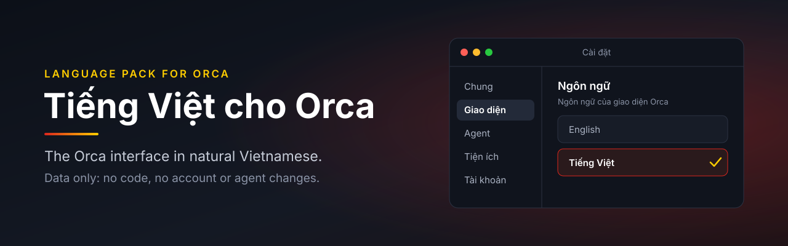

<div align='center'>



<br>

[](LICENSE)
[](CHANGELOG.md)
[](https://github.com/stablyai/orca)
[](#coverage)

**A Vietnamese language pack for [Orca](https://github.com/stablyai/orca), the app that runs several coding agents side by side.**

[Coverage](#coverage) · [Install](#install) · [Troubleshooting](#troubleshooting) · [How it is made](#how-it-is-made) · [Contributing](CONTRIBUTING.md)

</div>

---

Tiếng Việt cho Orca puts the Orca interface into natural Vietnamese, in the words people who build software use every day. It is a data-only plugin: it runs no code, requests no capabilities, and does not touch your accounts, agents or quota.

## Coverage

Built against the English catalog of Orca **1.4.256**, which has 19,624 strings.

| Strings | Count | Share |
| --- | ---: | ---: |
| Translated | 17,443 | 88.89% |
| Kept in English on purpose | 792 | 4.04% |
| Protected by Orca | 1,389 | 7.08% |
| Missing | 0 | 0% |

Strings kept in English are product names, glossary terms, URLs and examples, search keywords, commands and strings with nothing to translate. Each one has a reason in [`tools/keep-english.json`](tools/keep-english.json). Protected strings are trust prompts, security surfaces, destructive confirmations and native message boxes, which Orca does not let a language pack replace.

Orca offers a language only when it covers at least 80% of the main catalog. This pack covers 99%, and 95% of everything a pack may translate. Strings added in a later Orca release appear in English until the pack catches up.

## Install

Requires Orca 1.4.256 or newer.

1. Download `orca-vietnamese-1.4.0.zip` from the [latest release](https://github.com/Miinwan/orca-vietnamese/releases/latest) and unzip it, or clone the repository:

   ```sh
   git clone https://github.com/Miinwan/orca-vietnamese.git
   ```

2. In Orca, open **Settings → Plugins → Install plugin**.
3. Choose **Local folder**, pick the folder that contains `orca-plugin.json`, then choose **Install**. If Orca shows a permission review, check the name **Tiếng Việt cho Orca** and confirm.
4. Open **Settings → Appearance → Language** and choose **Tiếng Việt**.

To switch back, open **Cài đặt → Giao diện → Ngôn ngữ** and choose **English**.

Orca copies the plugin into its user data when you install it, so a new version of this pack needs the same steps. Orca updates do not remove the plugin. Install through Orca rather than copying files into its data folder.

## Troubleshooting

| Problem | What to do |
| --- | --- |
| **Tiếng Việt** is not in the Language list | Update Orca to 1.4.256 or newer. If an older version of the pack is installed, remove it and install this one. |
| Orca rejects the folder | Enter the full path to the folder that contains `orca-plugin.json`. |
| Orca will not overwrite the plugin | Remove the old version under **Settings → Plugins**, then install again. |
| The text did not change | Close and reopen the Settings window. |
| A string is still in English | It may be new in your Orca version or kept on purpose. If it looks wrong, [open an issue](https://github.com/Miinwan/orca-vietnamese/issues/new/choose). |

## How it is made

Terms and style follow [the glossary](docs/glossary.md). Labels stay close to the English length so they do not overflow, and common developer words such as agent, workspace, worktree, branch and commit stay in English.

The first release started from a machine draft made with the macOS Translation API, then went through several review passes and a check in the running app. Newer strings are written directly against the glossary and cross-checked on a random sample.

| Path | Contents |
| --- | --- |
| `orca-plugin.json` | Plugin manifest |
| `locales/vi.json` | Built Vietnamese catalog, the file Orca loads |
| `sources/` | English catalogs from Orca and the machine drafts |
| `tools/review/` | Reviewed translations, loaded in file name order |
| `tools/overrides.json` | Manual fixes, highest priority |
| `tools/keep-english.json` | Strings kept in English, with reasons |
| `tools/protected-keys.mjs` | Keys Orca does not let a pack replace |
| `tools/build-pack.mjs` | Merges everything into `locales/vi.json` |
| `docs/glossary.md` | Terms and style rules |

To fix a translation or rebuild the pack, see [CONTRIBUTING.md](CONTRIBUTING.md).

## License

MIT, see [LICENSE](LICENSE). The English catalogs in `sources/` come from Orca and are covered by [THIRD_PARTY_NOTICES.md](THIRD_PARTY_NOTICES.md).
